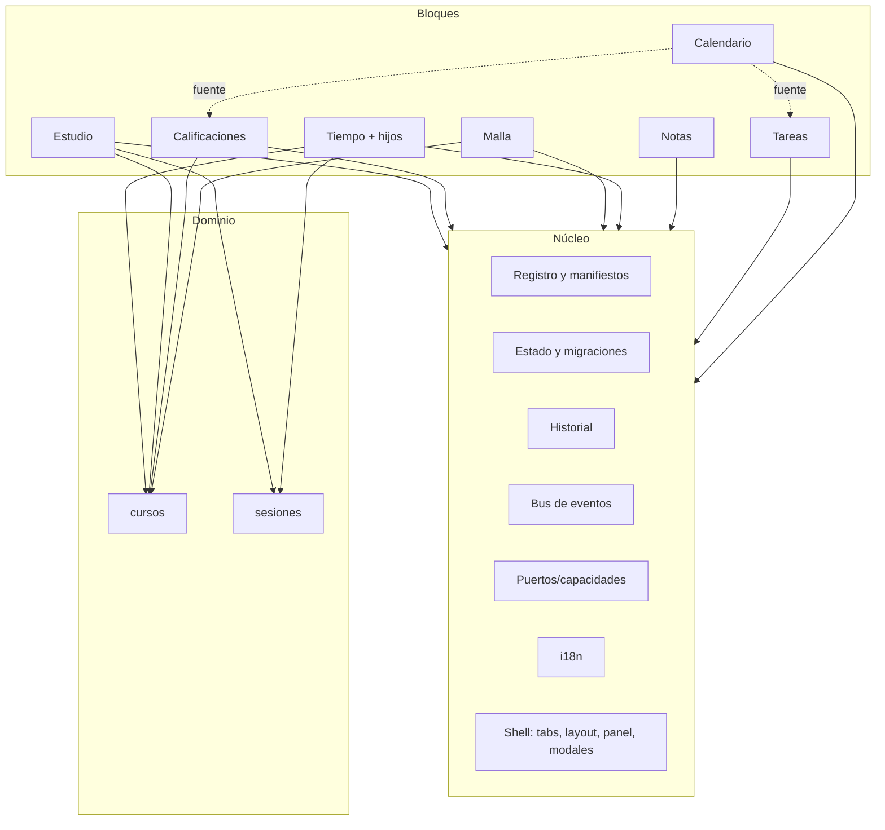
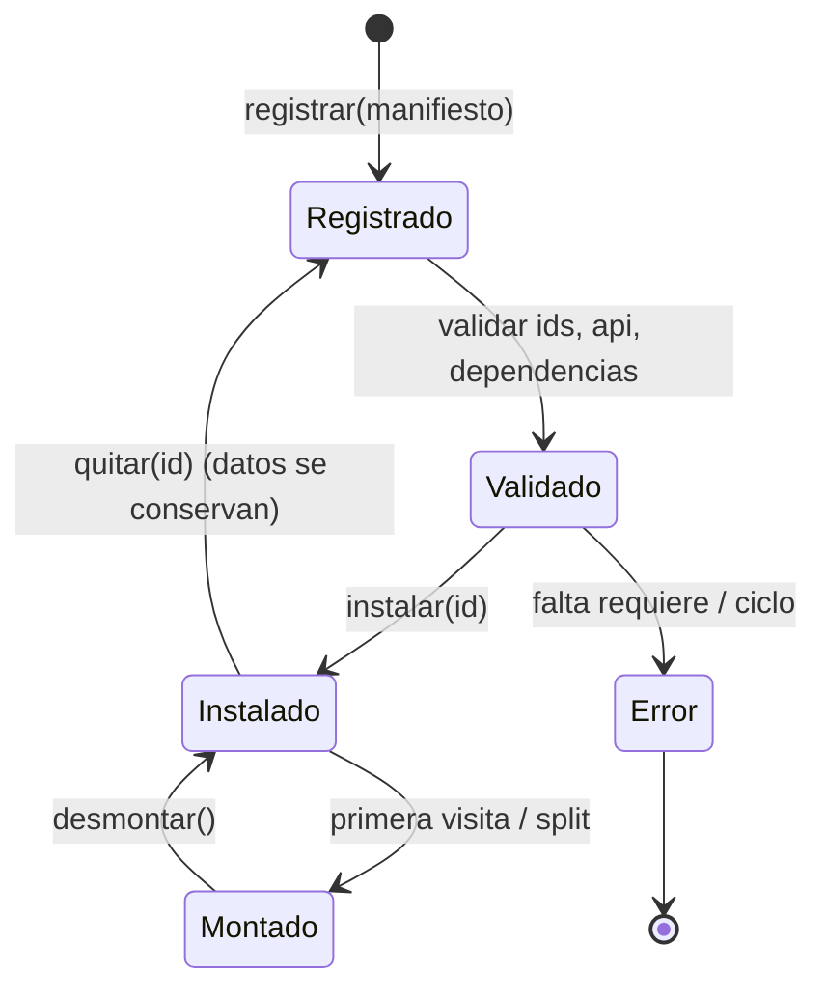

# Mimo — arquitectura de bloques y plan para la beta.3

**Estado:** documento de planificación. No se modificó código de la app.
**Base:** `main` en `c71ebe3` (R47).
**Rama:** `t/mimo-beta3-bloques`.
**Fecha:** 2026-10-30.
**Para quién:** el próximo agente que retome este trabajo, y el dueño del proyecto.

> **Si perdiste el contexto, lee en este orden:** §1 (diagnóstico), §5 (arquitectura
> propuesta), §7 (fases) y §10 (próximo paso). Las referencias de línea son sobre
> `c71ebe3`; después de mover código, usa los nombres de función, no los números.

---

## 1. Resumen ejecutivo

Mimo tiene hoy un **catálogo de bloques**, pero no una **arquitectura de bloques**.
El catálogo (`BLOQUES`, `instalados`, `kits`) decide qué pestañas se ven; el código,
el HTML, el CSS, los textos y el estado siguen siendo un solo bloque monolítico.
Instalar o quitar un bloque cambia la barra, pero no monta ni desmonta su código,
no aísla sus datos y no impide que ese bloque llame por dentro a otro.

Eso no es contradictorio con que Mimo sea un único ejecutable. Un **monolito modular**
sigue siendo un solo despliegue, pero con módulos independientes, contratos explícitos
y datos con dueño. La contradicción real es otra: Mimo vende bloques y los implementa
como una sola masa de código.

La recomendación es construir un **monolito modular con microkernel**:

- **Núcleo:** registro, estado, historial, eventos, puertos, i18n, shell y layout.
- **Dominio:** entidades compartidas y estables (`cursos`, `sesiones`), sin DOM.
- **Bloques:** UI y flujo de cada sección; se montan y desmontan; no se llaman entre sí.
- **Packs:** metadatos de instalación (Academics), no bloques de ejecución.

No hace falta pasar a micro-frontends, ni a React, ni a un bundler, ni a módulos ES
para la beta.3. Eso agregaría riesgo y rompería los gates actuales, que abren la app
como `file://`. La app puede seguir siendo un solo binario y un solo `index.html`
mientras los bloques sean piezas de verdad.

**Resultado esperado:** agregar un bloque = una carpeta + un manifiesto + una línea en
el registro; quitarlo = borrar esa línea y su carpeta, sin dejar pestañas huérfanas,
sin borrar datos y sin tocar el núcleo. Cada bloque puede montarse solo, con
dependencias opcionales declaradas, y la app sigue funcionando si faltan.

---

## 2. Lo que se pidió y cómo se interpreta

Pediste, en esencia:

1. Abrir una rama para la beta.3.
2. Trabajar en **solo lectura y planificación** (sin cambiar el comportamiento).
3. Entender por qué Mimo, que se presenta como bloques, es en realidad un solo código.
4. Poder **agregar y quitar bloques** sin deformar la app ni quitarle sentido.
5. Que los bloques **no dependan necesariamente de otros**; ejemplo: Tiempo hoy
   depende de Tareas y del calendario de ramos.
6. Que al agregar bloques se **sume o modifique** comportamiento, pero que cada uno
   pueda existir sin los demás.
7. **Desarmar** el código en piezas o carpetas ordenadas por bloque o por conjunto
   con sentido.
8. Estudiar en la web estrategias para resolverlo.
9. Dejar un **informe `.md` durable**, para que resista las compactaciones de contexto.

Interpretación de trabajo:

- **“Sin dependencias” no significa independencia absoluta.** Dos bloques que miran
  los mismos datos (ramos, sesiones, eventos) siempre tienen algún acoplamiento. Lo
  que se puede eliminar es la **dependencia oculta**: llamadas directas, estado
  compartido sin dueño y borrados en cascada. Lo que queda se declara: dependencia
  dura, dependencia opcional o aporte.
- **“Desarmar” no significa partir el ejecutable.** Mimo es offline y se distribuye
  como un binario Tauri. Partirlo en aplicaciones independientes sería peor para el
  producto. Lo que hay que desarmar es el **código fuente** y el **contrato** entre
  piezas, no el despliegue.
- **“Parcialmente dinámico”**: instalar/quitar en caliente, montar solo lo visible y
  cargar el código de un bloque cuando se usa. La carga dinámica de código de
  terceros queda fuera de la beta.3.

---

## 3. Diagnóstico del código actual

### 3.1 Tamaño y forma

| Pieza | Medida | Qué implica |
|---|---:|---|
| `app/js/shell.js` | 4.511 líneas, ~272 KB | UI, estado, lógica de todos los bloques y kernel en un archivo |
| `app/js/sync.js` | 1.044 líneas | Sincronización genérica; depende de `MimoHost` |
| `app/js/esquema.js` | 362 líneas | Import/export de documentos; conoce `cursos`/`califs` |
| `app/js/mimo-juego.js` | 38 líneas | Easter egg; no participa del modelo |
| `app/index.html` | 729 líneas | Las 8 secciones están siempre en el DOM |
| `app/css/shell.css` | 764 líneas | Estilos de todos los bloques en un archivo |
| `app/css/base.css` + `tokens.css` | 229 líneas | Base y tokens compartidos |
| `app/tutorial.json` | 242 líneas | Tutorial precargado; menciona bloques y kit |
| Textos i18n | 447 claves | Un solo diccionario para toda la app |
| Gates web | 16 | Todos abren `app/index.html` como `file://` |
| Medidas Tauri | 33 | Binario release, tutorial, sync nativa, persistencia |

Las secciones del HTML son:

| Sección | Línea en `index.html` | ¿Se puede quitar hoy? |
|---|---:|---|
| Calendario | 124 | No: es base fija |
| Tareas | 164 | No: es base fija |
| Notas | 205 | No: es base fija |
| Tiempo | 248 | Sí: `instalados` |
| Malla | 278 | Sí: kit Academics |
| Calificaciones | 367 | Sí: kit Academics |
| Estudio | 386 | Sí: kit Academics |
| Ajustes | 430 | No: es base fija |

Además existe `evaluaciones` en `BLOQUES` como “aporte”, pero **no tiene sección, ni
código, ni vista**. El dueño indicó que tendrá su propio sistema de notas y
clasificación; por ahora es una pieza **pendiente de diseño**, no un bloque eliminable.
No se toca hasta definir ese sistema.

### 3.2 Qué es un “bloque” hoy

Hoy un bloque es solamente una **ficha de catálogo**:

- `BLOQUES` (líneas 251–258) guarda nombre, tipo, origen, naturaleza, tags, icono y
  descripción.
- `BASE` (259) fija Calendario, Tareas, Notas y Ajustes.
- `secciones()` (796–812) arma la barra con `BASE` + `estado.instalados`.
- `instalar()` / `quitar()` (3729–3753) solo agregan o quitan IDs de
  `estado.instalados` y `estado.kits`.
- El HTML de la sección ya existe siempre; el código de sus funciones ya está cargado
  siempre; el CSS y los textos ya están siempre.
- `init()` (3882–3904) pinta **todos** los bloques, estén instalados o no.
- `ir()` (882–914) tiene un `if` por sección; `pintarPanel()` (3084–3231) tiene un
  `if` por sección; `resultadosBusqueda()` (3467–3505) recorre todos los datos a mano.

En otras palabras: **instalar un bloque enciende una pestaña; no monta un módulo.**
Por eso el código no cumple la promesa del producto, aunque la interfaz sí lo parezca.

### 3.3 Dependencias entre bloques (llamadas directas)

Esta tabla sale de leer `shell.js` y buscar llamadas entre las franjas de cada bloque.
No es un grafo perfecto (JavaScript tiene callbacks y hoisting), pero muestra el
acoplamiento real:

| Bloque | Llama a funciones de… | Ejemplos |
|---|---|---|
| Calendario | Estudio, Ajustes/Periodos, Panel | `colorDeContexto`, `textoSobre`, `periodoActivoObj`, `horaTexto`, `pintarPanel` |
| Tareas | Calendario, Panel | `hoyISO`, `pintarPanel` |
| Malla | Calificaciones, Estudio, Calendario, Panel | `califDe`, `presentacionDe`, `notaFinalDe`, `fmtNota`, `pintarCalificaciones`, `colorDeRamo`, `selloLocal` |
| Calificaciones | Malla, Calendario, Panel | `normalizarCursos`, `ramoPorCodigo`, `cerrarCurso`, `reabrirCurso`, `eventoPorId`, `pintarCalendario` |
| Estudio | Malla, Calendario/Ajustes, Panel | `normalizarCursos`, `ramoPorCodigo`, `periodoActivoObj`, `pintarPanel` |
| Notas | Tareas, Calendario | `tareaPorId`, `eventoPorId` (para el selector de vínculo) |
| Tiempo | Tareas, Malla, Estudio, Calendario | `tareaPorId`, `ramoPorCodigo`, `pintarEstudio`, `fmtHoras`, `hoyISO` |
| Panel / Buscador / Ajustes / Init | Todos | switches y listas hard-codeadas |

Los casos más graves:

- **Malla → Calificaciones:** para cerrar un ramo, `alternarRamo()` y `cerrarCurso()`
  calculan la nota con `califDe`, `presentacionDe` y `notaFinalDe` (1608, 1623–1626).
  Si Calificaciones no está, Malla no puede cerrar por nota; solo por confirmación
  manual.
- **Calificaciones → Malla:** `pintarCalificaciones()` lista `estado.cursos` y, si no
  hay, muestra “Calificaciones usa los ramos de Malla” (2153–2154). El botón
  `#calif-crear-ramo` navega a Malla (4222). Sin Malla, Calificaciones queda vacía.
- **Calificaciones → Calendario:** `sincronizarEventoComp()` escribe y borra
  `estado.eventos` (2211–2226, 2251–2252). Calificaciones es dueña de datos de
  Calendario sin declararlo.
- **Tiempo → Tareas / Malla / Estudio:** los selectores leen `estado.tareas` y
  `estado.cursos` (2911–2923); al registrar una sesión llama `pintarEstudio()`
  (2964). El cronómetro funciona sin ellos, pero el código no lo sabe.
- **Estudio → Malla / Periodos:** `pintarEstudio()` usa `estado.cursos` y
  `periodoActivoObj()` (2357–2364). Sin cursos, la tabla dice “Crea uno en Malla”
  (2478); sin periodos, cae a 8 semanas móviles (2340–2353), lo cual ya es una
  degradación aceptable.
- **Calendario → Estudio:** `colorDeContexto()` y `textoSobre()` viven en la franja
  de Estudio, pero Calendario las usa para pintar eventos (1021, 1052).

### 3.4 Datos: quién los toca

| Dato | Dueño natural | Otros que escriben hoy | Riesgo |
|---|---|---|---|
| `tareas` | Tareas | init/tutorial, sync | Bajo |
| `notas` | Notas | sync | Bajo |
| `eventos` | Calendario | **Calificaciones**, init/tutorial, sync | Alto |
| `cursos` | Malla | **Calificaciones** (renombrar/borrar), sync | Alto |
| `califs` | Calificaciones | **Malla** (borrar/renombrar), sync | Alto |
| `sesiones` | Tiempo y Estudio | ambos + sync | Alto |
| `periodos` | Calendario/Ajustes | sync | Medio |
| `estudio` | Estudio | sync | Medio |
| `tiempoModo`, `tiempoHijos`, `tiempoVinculo`, `tiempoRamo`, `tempMin`, `pomo`, `alarmas` | Tiempo | sync | Bajo |
| `prefs`, `panel`, selecciones | Shell | todos | Alto (global) |
| `instalados`, `kits` | Shell | catálogo | Medio |

Casos destructivos concretos:

1. `normalizarCalifs()` borra las calificaciones de todo curso que no esté en
   `estado.cursos` (1966). Si Malla está vacía o se quitó, se pierden notas.
2. `borrarRamo()` borra `estado.califs[codigo]` (1669) y limpia requisitos de otros
   ramos (1670–1674). Es un borrado en cascada entre dos bloques.
3. `accionCalif()` borra un evento del calendario al quitar un componente (2251–2252).
4. `borrarSesion()` y `guardarSesionModal()` (558–604) editan sesiones desde la zona
   de acciones, fuera de Tiempo y Estudio.
5. `reemplazarEstado()` normaliza y repinta todos los bloques a mano (468–476),
   aunque el bloque no esté instalado.

### 3.5 Por qué se siente contradictorio

Porque hay tres cosas distintas que hoy comparten el mismo nombre:

1. **Bloque de producto:** una ficha que el usuario instala.
2. **Bloque de código:** una carpeta con su UI, su estado y su contrato.
3. **Bloque de datos:** una porción del estado con dueño, migración y exportación.

Mimo solo tiene la primera. La segunda y la tercera están diluidas en `shell.js`.
La solución no es “partir el archivo en pedazos” sin más: es darle a cada bloque las
tres dimensiones y un contrato entre ellas.

---

## 4. Estrategias estudiadas

### 4.1 Micro-frontends: no para Mimo

La literatura de micro-frontends propone componer aplicaciones independientes en
tiempo de ejecución; su ventaja fuerte es la autonomía de equipos y el despliegue
independiente. Martin Fowler describe la integración por JavaScript con una función
global de montaje/desmontaje como contrato, y también lista sus costos: duplicación
de dependencias, diferencias de entorno y complejidad operativa.

Para Mimo no encaja:

- Hay **un solo equipo** y **un solo despliegue** (binario Tauri).
- No hay carga remota ni servidores por bloque; la app es offline.
- Introducir iframes/Web Workers/micro-apps duplicaría estado, rompería el `file://`
  de los gates y complicaría el tema, el foco y la accesibilidad.
- El usuario no gana nada con “desplegar” un bloque por separado.

Pero sí conviene tomar prestado su contrato de tiempo de ejecución: el shell dice
**dónde** montar y **cuándo** desmontar; el bloque no asume una página completa.
Eso es exactamente el ciclo `montar/desmontar` que necesita Mimo, sin partir el
despliegue.

> Referencia: [Micro Frontends, Martin Fowler](https://martinfowler.com/articles/micro-frontends.html).

### 4.2 Monolito modular: el marco correcto

Kamil Grzybek define el monolito como **una sola unidad de despliegue**, y aclara
que eso no dice nada sobre la calidad ni sobre la modularidad. Un monolito modular
tiene módulos independientes e intercambiables, cada uno con todo lo necesario para
su función y con una **interfaz/contrato** explícito; lo que se comparte fuera es la
API pública del módulo, y la implementación queda encapsulada.

Eso es Mimo: un binario, muchos módulos. El objetivo no es “microservicios” ni
“micro-frontends”, sino **límites de código y contratos** dentro del mismo binario.
La metáfora de Lego encaja si se entiende así: las piezas tienen un conector estándar
(el contrato); no necesitan ser fábricas separadas.

> Referencia: [Modular Monolith: A Primer, Kamil Grzybek](https://www.kamilgrzybek.com/blog/posts/modular-monolith-primer).

### 4.3 Microkernel / plug-ins: núcleo chico, piezas grandes

El patrón Plugin de Fowler separa la configuración del código: las clases se enlazan
en tiempo de configuración, no de compilación. Un microkernel lleva eso a la
arquitectura: el núcleo ofrece los servicios mínimos (registro, ciclo de vida,
comunicación, estado) y los plug-ins aportan la funcionalidad.

Grafana documenta un ciclo de vida útil para copiar:

1. descubrimiento de plug-ins;
2. validación;
3. registro en memoria;
4. carga diferida del `module.js`;
5. una sola carga de código, pero **múltiples instancias**;
6. desinstalación/limpieza.

Para Mimo: el núcleo no sabe qué es “Tiempo” ni “Malla”; solo sabe registrar bloques,
resolver dependencias, montar, desmontar y enrutar eventos. Los bloques no se conocen
entre sí; conocen capacidades.

> Referencias: [Plugin, Martin Fowler](https://martinfowler.com/eaaCatalog/plugin.html);
> [Life cycle of a plugin, Grafana](https://grafana.com/developers/plugin-tools/key-concepts/plugin-lifecycle).

### 4.4 Vertical slices: una carpeta por bloque, no una capa por tecnología

Jimmy Bogard propone organizar por **rebanadas verticales** de funcionalidad:
minimizar el acoplamiento entre rebanadas y maximizar la cohesión dentro de una.
No es “una carpeta `controllers`, otra `services`, otra `repositories`”; es una
carpeta por caso de uso que contiene lo que necesita.

Para Mimo: `bloques/tiempo/` debe contener su vista, su estado, sus textos, sus
estilos y sus pruebas. Lo compartido (botones, modales, formato, sanitizado) va a
`nucleo/ui/`. Lo compartido de dominio (cursos, sesiones) va a `dominio/`, no a un
bloque.

> Referencia: [Vertical Slice Architecture, Jimmy Bogard](https://www.jimmybogard.com/vertical-slice-architecture/).

### 4.5 Puertos y adaptadores: dependencias opcionales de verdad

La arquitectura hexagonal de Cockburn separa el interior de la aplicación de los
dispositivos externos mediante **puertos** (interfaces por propósito) y **adaptadores**
(implementaciones). La aplicación puede funcionar sin una UI o sin una base de datos
concreta; los adaptadores se sustituyen.

Aplicado a bloques: Tiempo no debería llamar `tareaPorId()` de Tareas. Debería declarar
un puerto opcional `tareas.listar` y consumirlo si existe. Si Tareas no está, el puerto
devuelve `null`, el selector se oculta y el cronómetro sigue funcionando. Ese es el
cambio conceptual más importante: **la dependencia se invierte**; el consumidor define
lo que necesita, el proveedor lo implementa.

> Referencia: [Hexagonal Architecture, Alistair Cockburn](https://alistair.cockburn.us/hexagonal-architecture/).

### 4.6 Eventos: notificación, no cadena de órdenes

Fowler distingue eventos de comandos. Un evento notifica “pasó algo”; un comando pide
“haz esto”. Los eventos bajan el acoplamiento, pero si se usan como órdenes encubiertas
(“evento pasivo-agresivo”) el flujo se vuelve difícil de seguir.

Para Mimo:

- **Comando:** “cerrar curso”, “registrar sesión”, “crear evento”. Va por un puerto y
  tiene un resultado claro.
- **Evento:** “sesión registrada”, “curso cerrado”, “tarea completada”. Sirve para que
  otros se actualicen, no para que el emisor espere una acción.
- No encadenar eventos: si un handler emite otro evento, documentarlo y limitar la
  profundidad. Mejor un comando explícito.

> Referencia: [What do you mean by “Event-Driven”?, Martin Fowler](https://martinfowler.com/articles/201701-event-driven.html).

### 4.7 Dominio compartido: el pegamento que hoy está escondido

Los acoplamientos más fuertes no son “bloque A llama a bloque B”, sino **datos
compartidos**: cursos, sesiones, eventos. Calificaciones, Estudio, Tiempo y Malla
miran los mismos ramos. Tiempo y Estudio escriben las mismas sesiones. Calificaciones
escribe eventos del calendario.

Hay dos formas de resolverlo:

- **Dueño único + capacidad:** Malla es dueña de `cursos`; los demás piden
  `cursos.listar`. Si Malla no está, no hay cursos y los consumidores degradan.
- **Dominio compartido:** `dominio/cursos.js` y `dominio/sesiones.js` son servicios
  estables, sin DOM, usados por varios bloques. Malla es la vista/editora de cursos;
  Calificaciones y Estudio los consumen sin depender de la UI de Malla.

Para Mimo recomiendo la segunda para **cursos** y **sesiones**, y la primera para
**tareas**, **notas**, **eventos** y **calificaciones**. Razón: cursos y sesiones son
entidades que existen aunque su bloque de UI no esté; tareas/notas/eventos tienen un
dueño natural y no necesitan servicio de dominio separado.

El dominio compartido debe ser **delgado y estable**: entidades, validación, IDs,
migraciones y eventos. Nada de HTML, nada de temas, nada de “pintar”. Si empieza a
crecer, es señal de que se está metiendo producto ahí.

> Referencia: [Bounded Context, Martin Fowler](https://martinfowler.com/bliki/BoundedContext.html).

### 4.8 Web Components y Shadow DOM: después, no ahora

Los custom elements tienen un ciclo de vida (`connectedCallback`,
`disconnectedCallback`) que se parece a `montar`/`desmontar`, y Shadow DOM da
aislamiento de CSS. Pero:

- El tema actual depende de variables CSS en `body` y de selectores globales; Shadow
  DOM rompería la herencia de estilos y obligaría a duplicar tokens.
- Los gates y el CSS actual consultan IDs y clases globales.
- La accesibilidad y el foco entre raíces sombra agregan complejidad.
- No hay plugins de terceros en beta.3; no hace falta aislamiento fuerte.

Recomendación: DOM normal, raíz por bloque, clases prefijadas (`b-tiempo-…`), CSS por
bloque y tokens compartidos. Si más adelante hay plugins externos, ahí sí se evalúa
Shadow DOM o iframe aislado.

> Referencias: [Custom elements, MDN](https://developer.mozilla.org/en-US/docs/Web/API/Web_components/Using_custom_elements);
> [Shadow DOM, MDN](https://developer.mozilla.org/en-US/docs/Web/API/Web_components/Using_shadow_DOM).

### 4.9 Módulos ES: buenos, pero rompen los gates actuales

Los módulos ES (`import`/`export`) son la forma nativa de dividir código, pero el
navegador los carga con CORS y no funcionan desde `file://`. Los 16 gates abren
`app/index.html` con `page.goto(file://…)`. Lo verifiqué en esta sesión: un
`<script type="module">` desde `file://` falla con “blocked by CORS policy”.

Opciones:

- **Beta.3:** scripts clásicos + registro. Es lo que ya usa la app; no rompe gates ni
  Tauri; se puede cargar un bloque con inyección de `<script>` (probado: funciona
  desde `file://`).
- **Después:** mover los gates a un servidor HTTP local o empaquetar con un bundler;
  entonces sí `import`/`export` y carga diferida real.

No conviene mezclar la migración de módulos con la de bloques: son dos riesgos
distintos. Primero se separan los bloques; después se cambia el sistema de carga.

> Referencia: [JavaScript modules, MDN](https://developer.mozilla.org/en-US/docs/Web/JavaScript/Guide/Modules).

### 4.10 Manifiestos: aprender de WordPress y Grafana

`block.json` de WordPress es un buen modelo de manifiesto: nombre único, versión,
título, descripción, icono, categoría, atributos, scripts y estilos por bloque, y
carga de assets solo cuando el bloque se usa. No necesitamos su modelo de edición,
pero sí su idea: **el bloque se describe a sí mismo**; el catálogo no mantiene una
lista paralela.

Grafana aporta la otra mitad: registro en memoria, validación, carga diferida y
múltiples instancias. Mimo puede tener un manifiesto JS (no JSON, por `file://`) con
la misma información y un registro que lo valide.

> Referencia: [Metadata in block.json, WordPress](https://raw.githubusercontent.com/WordPress/gutenberg/trunk/docs/reference-guides/block-api/block-metadata.md).

### 4.11 Feature-Sliced Design: la API pública de cada carpeta

FSD insiste en capas, slices y segmentos, y en que un módulo solo consuma la API
pública de otro. No hace falta adoptar sus siete capas, pero sí dos reglas:

- Cada bloque exporta una **API pública** pequeña (`bloque.js`); nadie importa sus
  archivos internos.
- Cada bloque tiene sus **segmentos** internos: `vista`, `estado`, `i18n`, `estilos`,
  `pruebas`.

Eso evita el “import profundo” que vuelve a acoplar todo.

> Referencia: [Feature-Sliced Design: Overview](https://feature-sliced.design/docs/get-started/overview).

### 4.12 Strangler Fig: migrar sin reescribir

No conviene reescribir Mimo desde cero. El patrón Strangler Fig propone crecer el
código nuevo alrededor del viejo, mover comportamiento por partes y mantener ambos
funcionando durante la transición. Es exactamente lo que necesita `shell.js`: primero
un registro que envuelva las funciones actuales, después extraer una sección, después
otra, con los gates como red de seguridad.

> Referencia: [Strangler Fig, Martin Fowler](https://martinfowler.com/bliki/StranglerFigApplication.html).

### 4.13 Comparación rápida

| Estrategia | Resuelve | Costo | ¿Para beta.3? |
|---|---|---|---|
| Micro-frontends | autonomía de equipos/despliegue | alto; iframes/duplicación | No |
| Monolito modular | límites y contratos en un binario | medio | **Sí, marco general** |
| Microkernel/plugin | núcleo + piezas | medio | **Sí** |
| Vertical slices | carpetas por bloque | bajo | **Sí** |
| Puertos/adaptadores | dependencias opcionales | medio | **Sí** |
| Eventos | desacoplar notificaciones | bajo/medio | **Sí, limitado** |
| Dominio compartido | cursos/sesiones sin dueño de UI | medio | **Sí, para 2 entidades** |
| Web Components/Shadow DOM | aislamiento fuerte | alto | No (salvo futuro) |
| Módulos ES | división nativa | alto por gates | No en beta.3 |
| Bundler/framework | tooling y ecosistema | alto | No |

---

## 5. Arquitectura propuesta

### 5.1 Principios

1. **Un solo despliegue, muchos módulos.** El binario Tauri no se parte.
2. **El núcleo no sabe de dominio.** No conoce “tareas” ni “ramos”; solo registra,
   guarda, emite y monta.
3. **Cada bloque es dueño de su UI y de su flujo.** No toca el DOM de otro.
4. **Cada dato tiene dueño.** O es de un bloque, o es una entidad de dominio estable.
5. **Las dependencias se declaran.** Dura, opcional o aporte. Nada de llamadas
   directas entre bloques.
6. **Quitar un bloque no borra datos.** Se desmonta la UI y se desregistra la
   capacidad; los datos quedan para cuando vuelva.
7. **Cada bloque puede montarse solo.** Con puertos falsos o vacíos, en un arnés de
   pruebas, sin el resto de la app.
8. **La API pública es chica.** Un `bloque.js` por bloque; lo demás es interno.
9. **Compatibilidad primero.** Mismos IDs, mismo `localStorage`, mismos documentos de
   exportación, mismos gates.
10. **Sin tooling nuevo en beta.3.** Nada de bundler, framework o módulos ES.

### 5.2 Capas



Lectura:

- **Núcleo** no tiene UI de negocio; tiene el shell y los servicios.
- **Dominio** son dos servicios sin DOM: cursos y sesiones. Si mañana se agrega otro
  dato compartido, se evalúa; no es un cajón de sastre.
- **Bloques** contienen la vista, los bindings, los textos, los estilos y las
  contribuciones (panel, búsqueda, ajustes, fuentes de calendario).
- Las flechas punteadas son **opcionales**: Calendario puede mostrar tareas o
  componentes con fecha si esos bloques están; si no, sigue funcionando.

### 5.3 Estructura de carpetas

```text
app/
  index.html                 # solo shell: topbar, tabs, contenido vacío, panel, modales
  js/
    nucleo/
      arranque.js            # carga manifiestos, registra, monta el bloque inicial
      registro.js            # registrar/validar/ordenar/montar/desmontar
      estado.js              # localStorage, slices, migraciones, guardar
      eventos.js             # bus con try/catch por handler
      puertos.js             # capacidades: registrar, obtener, requiere
      historial.js           # deshacer/rehacer por snapshot
      i18n.js                # diccionario base + merge de bloques
      shell.js               # tabs, layout, split, panel host, modales
      ui.js                  # esc, icono, toast, confirmar, formato, markdown
    dominio/
      cursos.js              # entidad curso: CRUD, color, validación, eventos
      sesiones.js            # entidad sesión: CRUD, duración, validación, eventos
    bloques/
      calendario/
        bloque.js            # manifiesto + montar/desmontar + contribuciones
        vista.js             # plantilla y bindings
        estado.js            # migración/normalización propia (si no es dominio)
        i18n.js
        estilos.css
      tareas/
      notas/
      tiempo/
        bloque.js            # padre: estantería, modo activo, contexto de sesión
        hijos/
          crono/bloque.js
          temporizador/bloque.js
          pomodoro/bloque.js
          alarmas/bloque.js
      malla/
      calificaciones/
      estudio/
    sync.js                  # se queda casi igual; usa MimoHost genérico
    esquema.js               # se queda; import/export genérico
    mimo-juego.js
  css/
    base.css
    tokens.css
    shell.css                # solo shell
    bloques/<id>.css
  vendor/
```

Notas:

- `index.html` deja de tener las 8 secciones; solo tiene los hosts y el shell.
- Cada bloque tiene su propia carpeta y su propio `estilos.css`.
- `dominio/` no tiene HTML ni conoce el tema.
- `nucleo/` no tiene `if (id === "malla")`.
- `sync.js` y `esquema.js` quedan fuera del refactor de bloques; su contrato es el
  estado completo y los documentos actuales.

### 5.4 Contrato de bloque

Manifiesto mínimo (JS, no JSON, para que funcione en `file://`):

```js
Mimo.registrarBloque({
  id: "tiempo",
  nombre: "Tiempo",
  version: "2.0.0",
  api: 1,
  tipo: "seccion",              // seccion | aporte | pack | hijo
  origen: "nativo",             // nativo | kit | plugin
  fija: false,
  padre: null,                  // en un hijo: "tiempo"
  icono: "i-tiempo",
  desc: "Cronómetro, temporizador, pomodoro y alarmas.",
  tags: ["cronometro", "temporizador", "pomodoro", "alarmas"],

  requiere: [],                 // capacidades duras; si falta, no monta
  opcional: ["tareas.listar", "cursos.listar", "sesiones.registrar"],
  provee: [],                   // Tiempo no expone una capacidad propia; usa el dominio

  estado: {
    claves: ["tiempoModo", "tiempoHijos", "tiempoVinculo", "tiempoRamo"],
    version: 1,
    porDefecto: function () { /* … */ },
    migrar: function (datos, desde) { /* … */ }
  },

  montar: function (ctx) { /* pinta en ctx.root, bindea con ctx.signal */ },
  desmontar: function (ctx) { /* limpia; el kernel aborta ctx.signal */ },

  panel: {
    contexto: function (ctx) { return { html: "<h2>…</h2>", montar: function (root) {} }; },
    detalle: function (ctx) { return { html: "<h2>…</h2>", montar: function (root) {} }; }
  },
  buscar: function (q, ctx) { return []; },
  ajustes: function (ctx) { return { html: "", montar: function () {} }; },

  eventos: {
    emite: [],                  // el dominio emite sesiones.sesion.registrada
    escucha: ["tareas.tarea.borrada", "cursos.curso.borrado"]
  },

  estilos: ["css/bloques/tiempo.css"],
  i18n: { es: {}, en: {}, zh: {} }
});
```

No todo es obligatorio. La beta.3 puede empezar con `id`, `nombre`, `version`, `tipo`,
`icono`, `desc`, `estado`, `montar`, `desmontar`; las contribuciones se agregan cuando
se migra cada bloque.

Contexto que recibe el bloque:

```js
{
  id: "tiempo",
  root: HTMLElement,            // raíz propia; no document
  modo: "normal" | "split" | "standalone",
  signal: AbortSignal,          // para addEventListener(..., { signal })

  estado: {
    leer(): object,             // solo sus claves
    escribir(patch): void,
    actualizar(fn): void,
    version(): number
  },

  puertos: {
    tiene(nombre): boolean,
    obtener(nombre): any|null,  // null si no está
    requerir(nombre): any       // lanza si no está (solo para requiere)
  },

  eventos: {
    emitir(nombre, datos): void,
    escuchar(nombre, fn): () => void
  },

  ui: { esc, icono, toast, confirmar, modal, markdown, formato },
  i18n: { t(clave, vars), idioma() },
  navegar: { ir(id, params), abrir(id, params) },
  layout: { esSplit(), mover(...) }
}
```

Reglas del contrato:

- `root` es lo único que el bloque puede tocar. Nada de `document.querySelector("#…")`.
- `ctx.signal` se aborta al desmontar; ahí se van los listeners, intervalos y
  observadores.
- `estado` solo expone las claves declaradas. Si el bloque intenta leer otra, es un
  error de arquitectura, no una comodidad.
- `puertos.obtener` devuelve `null` si el proveedor no está; el bloque decide si
  oculta el control o muestra un aviso.
- `requiere` es para dependencias que impiden montar; `opcional` para las que solo
  degradan.
- `panel`, `buscar` y `ajustes` son funciones puras de render; no montan nada global.
- Los eventos no se usan para ordenar acciones; para eso está el puerto/comando.

### 5.5 Ciclo de vida



Detalles:

- **Registrar** no toca el DOM. Solo guarda el manifiesto y valida.
- **Validar** comprueba ID único, `api` soportada, dependencias declaradas, ciclos,
  y que `proveedor` no esté duplicado.
- **Instalar** agrega a `estado.instalados`, guarda, pinta tabs y, si es sección,
  navega a ella.
- **Montar** crea la raíz y llama `montar(ctx)`. Es perezoso: solo al visitar.
- **Desmontar** aborta `signal`, llama `desmontar(ctx)`, quita la raíz y desregistra
  capacidades/eventos.
- **Quitar** desmonta, quita de `instalados`, actualiza tabs. No borra datos.
- **Reemplazar estado** (import/sync) desmonta y vuelve a montar los bloques
  registrados; no repinta a mano.
- **Cambio de idioma/tema** no desmonta: el tema va por CSS variables; el idioma
  llama `repintar(ctx)` o vuelve a montar si el bloque no soporta actualización
  incremental.

### 5.6 Puertos y eventos: catálogo inicial

Puertos (nombres estables, versión 1):

| Puerto | Métodos | Provee | Consume |
|---|---|---|---|
| `tareas` | `listar(filtro)`, `obtener(id)`, `abrir(id)` | Tareas | Tiempo, Notas, Calendario |
| `cursos` | `listar()`, `obtener(codigo)`, `color(codigo)`, `abrir(codigo)` | Dominio (Malla edita) | Calificaciones, Estudio, Tiempo, Calendario |
| `calendario` | `crearEvento(datos)`, `abrirEvento(id)`, `registrarFuente(id, fn)` | Calendario | Calificaciones, Tareas |
| `sesiones` | `registrar(datos)`, `listar(filtro)`, `actualizar(id, datos)`, `borrar(id)` | Dominio | Tiempo, Estudio |
| `calificaciones` | `resumen(codigo)` | Calificaciones | Malla |
| `notas` | `listar(filtro)`, `abrir(id)` | Notas | Calendario, Tareas |

En producción, `cursos` y `sesiones` son servicios de **dominio siempre disponibles**;
en un arnés standalone pueden faltar. Por eso un bloque los declara opcionales:
nunca debe asumir que están.

Eventos (notificación, no orden):

| Evento | Emisor | Datos | Consumidores |
|---|---|---|---|
| `tareas.tarea.creada/actualizada/completada/borrada` | Tareas | `{id, ...}` | Calendario, Tiempo, Notas |
| `cursos.curso.creado/actualizado/cerrado/borrado` | Malla/Dominio | `{codigo, ...}` | Calificaciones, Estudio, Tiempo, Calendario |
| `calendario.evento.creado/actualizado/borrado` | Calendario | `{id, ...}` | Notas, Panel |
| `calificaciones.componente.actualizado/borrado` | Calificaciones | `{codigo, id, ...}` | Calendario (fuente) |
| `sesiones.sesion.registrada/actualizada/borrada` | Dominio | `{id, ...}` | Estudio, Tiempo |
| `estudio.meta.actualizada` | Estudio | `{...}` | Panel |
| `estado.reemplazado` | Núcleo | `{...}` | Todos |
| `idioma.cambiado` | Núcleo | `{idioma}` | Todos |

Reglas:

- Un evento lleva IDs y datos mínimos; el consumidor que necesita más consulta el
  puerto. Eso evita duplicar estado y “eventos gordos”.
- Cada handler se ejecuta aislado con `try/catch`; un bloque roto no tumba el bus.
- No hay orden garantizado entre handlers; si un flujo necesita orden, es un comando.
- Los eventos no se persisten ni se reproducen; son notificaciones de sesión.

### 5.7 Estado y migraciones

Se mantiene `localStorage['mimo.shell.v1']` y la forma actual. No se renombran claves
en beta.3. Se agrega metadata:

```json
{
  "_bloques": {
    "tiempo": { "version": 1 },
    "malla": { "version": 1 }
  },
  "tareas": [],
  "cursos": [],
  "sesiones": []
}
```

Reglas:

1. Cada bloque declara `claves` y `version` en su manifiesto.
2. `nucleo/estado.js` guarda el estado completo; los bloques solo escriben sus claves.
3. `normalizar` de un bloque **no borra datos de otro**. Si un curso no existe, la
   calificación queda huérfana y se muestra como “curso eliminado”; no se elimina.
4. `migrar(datos, desde)` se ejecuta al cargar y al importar, solo para las claves del
   bloque. Si el bloque no está cargado, sus datos quedan intactos.
5. `_bloques` se exporta dentro de `extensiones` (o se conserva como clave desconocida)
   para no perder versiones al mover el estado entre equipos.
6. `esquema.js` sigue exportando `mimo.entorno`, `mimo.malla` y `mimo.backup` con el
   mismo contrato. `mimo.malla` sigue llevando cursos/calificaciones; no se parte en
   beta.3.
7. `sync.js` sigue sincronizando el snapshot completo. No necesita saber de bloques.
8. El historial sigue siendo snapshot completo; deshacer no depende de bloques.

Migración de datos actuales:

- No hay que mover `tareas`, `notas`, `eventos`, `cursos`, `califs`, `sesiones` a un
  nuevo árbol. Se quedan donde están; el manifiesto declara qué claves usa cada uno.
- `_bloques` se inicializa con la versión 1 de los bloques registrados; si falta, se
  asume 1.
- `normalizarCalifs` deja de borrar; `borrarRamo` deja de borrar calificaciones; los
  eventos de calificaciones dejan de escribirse en `estado.eventos`.

### 5.8 UI: shell, panel, búsqueda, ajustes

**Shell (`index.html`)**

- Topbar, tabs, contenido vacío, panel, modales, toast, carga.
- Un `<main id="contenido">` con un host por bloque montado; no 8 secciones fijas.
- El tab se genera desde el registro; no hay `BASE` hard-codeada.
- `Ajustes` es parte del shell (siempre visible), no un bloque instalable.

**Montaje**

- El kernel crea `<section data-bloque="id">` con `id="p-<id>"` para preservar los IDs
  que usan los gates (`#p-calendario`, etc.).
- El bloque llena su raíz; puede usar template strings o construir DOM.
- En split, se **mueve** la raíz; no se clona. Así no hay IDs duplicados.
- Al desmontar, se quita la raíz y se aborta `signal`.

**Panel**

- `panel.contexto(ctx)` y `panel.detalle(ctx)` devuelven `{html, montar(root)}`.
- El kernel elige pestaña, inserta y llama `montar` para que el bloque bindee sus
  botones.
- Si el bloque no aporta panel, el kernel muestra el estado vacío.
- La pestaña “Bloques” y “Notas” son contribuciones del kernel/Notas; si Notas no
  está, se oculta.

**Búsqueda**

- `buscar(q, ctx)` devuelve `[{tipo, titulo, sub, accion}]`.
- El kernel agrega, ordena, limita y ejecuta `accion`; no conoce `malla` ni `tiempo`.
- Si un bloque no está montado, no aporta resultados.

**Ajustes**

- El kernel maneja apariencia, idioma, notificaciones, navegación, paneles, respaldo,
  sync, acerca de y colaborar.
- Cada bloque aporta su sección de ajustes (`ajustes(ctx)`), por ejemplo:
  - Calendario: periodos.
  - Tiempo: duración por defecto, pomodoro.
  - Estudio: meta semanal.
  - Malla: datos de carrera.
- Si Calendario no está, no hay UI de periodos; Estudio usa semanas móviles.

### 5.9 Carga y build

Para beta.3:

```html
<script src="vendor/…"></script>
<script src="js/nucleo/arranque.js"></script>
<script src="js/bloques/registro.js"></script>
<script src="js/sync.js"></script>
<script src="js/mimo-juego.js"></script>
```

`js/bloques/registro.js` es una lista clásica:

```js
window.MIMO_BLOQUES = [
  "js/dominio/cursos.js",
  "js/dominio/sesiones.js",
  "js/bloques/calendario/bloque.js",
  "js/bloques/tareas/bloque.js",
  "js/bloques/notas/bloque.js",
  "js/bloques/tiempo/bloque.js",
  "js/bloques/malla/bloque.js",
  "js/bloques/calificaciones/bloque.js",
  "js/bloques/estudio/bloque.js"
];
```

`arranque.js` inyecta cada script con `async = false`, espera `onload` y recién ahí
llama `Mimo.iniciar()`. Probado en esta sesión: la inyección de scripts clásicos
funciona desde `file://`; los módulos ES no. No hace falta `fetch` ni servidor.

Para agregar un bloque: carpeta + manifiesto + una línea en `registro.js`. Para
quitarlo: borrar la línea y la carpeta. El núcleo no cambia.

Carga diferida:

- Beta.3: todos los scripts first-party se cargan al inicio (352 KB; no es problema),
  pero **solo se monta** el bloque visible. Eso ya evita pintar 8 secciones.
- Futuro: `cargarBloque(id)` inyecta el script en la primera instalación; el registro
  guarda la ruta. No es necesario para beta.3.
- Terceros: fuera de alcance; requeriría manifiesto JSON, permisos y sandbox.

### 5.10 Pruebas y “architecture fitness”

Además de los 16 gates actuales:

`gate-bloques.py` (implementado en esta rama):

1. Cada manifiesto valida: ID único, `api`, dependencias, ciclos.
2. Instalar cada bloque solo, desde estado limpio; sin errores de consola; su sección
   aparece y su acción principal funciona.
3. Quitar cada bloque; la app sigue; no quedan tabs huérfanas; los datos siguen.
4. Reinstalar; los datos vuelven.
5. Dependencia dura faltante: mensaje claro, no crash.
6. Dependencia opcional faltante: UI degradada, acción principal funciona
   (Tiempo sin Tareas/Cursos; Estudio sin Tiempo; Calendario sin Cursos).
7. Fuente de calendario: componente de calificación con fecha aparece en Calendario
   sin duplicar `estado.eventos`; al borrar el componente, desaparece; la calificación
   sigue.
8. Split: mover un bloque no duplica IDs ni pierde estado.
9. Exportar/importar con un bloque desinstalado: sus datos se conservan.
10. `file://` y Tauri: mismo comportamiento.

`gate-arquitectura.py` (nuevo, estático):

- Los bloques no leen `estado.cursos`, `estado.tareas`, etc. fuera de su manifiesto.
- No hay llamadas directas a funciones de otro bloque.
- Cada bloque tiene `montar`, `desmontar` y `estilos`.
- Cada `requiere` está provisto por un bloque del registro.
- No hay IDs globales duplicados en plantillas.
- Los CSS de bloque usan tokens (`var(--…)`) y no colores hard-codeados.

Los gates actuales se mantienen; si un ID cambia, se actualiza el gate en el mismo
commit. No se declara verde por “se ve bien”.

---

## 6. Contrato por bloque

| Pieza | Datos propios | Requiere | Opcional | Provee | Emite |
|---|---|---|---|---|---|
| **Calendario** | `eventos`, `periodos`, `periodoActivo` | — | `cursos`, `tareas`, `calificaciones` (fuentes) | `calendario` | `calendario.evento.*`, `calendario.periodo.*` |
| **Tareas** | `tareas` | — | `cursos` (contexto) | `tareas` | `tareas.tarea.*` |
| **Notas** | `notas` | — | `tareas`, `eventos` (vínculos) | `notas` | `notas.nota.*` |
| **Tiempo** | `tiempoModo`, `tiempoHijos`, `tiempoVinculo`, `tiempoRamo` | — | `tareas`, `cursos`, `sesiones` | — | — |
| **Crono** | runtime | `padre: tiempo` | — | — | — |
| **Temporizador** | `tempMin`, runtime | `padre: tiempo` | — | — | — |
| **Pomodoro** | `pomo`, runtime | `padre: tiempo` | — | — | — |
| **Alarmas** | `alarmas` | `padre: tiempo` | — | — | — |
| **Malla** | `carrera`; edita `cursos` | — | `calificaciones.resumen` (cierre por nota) | — | `cursos.curso.*` (dominio) |
| **Calificaciones** | `califs` | — | `cursos`, `calendario` (fuente) | `calificaciones` | `calificaciones.componente.*` |
| **Estudio** | `estudio` | — | `cursos`, `periodos`, `sesiones` | `estudio` | `estudio.meta.*` |
| **Ajustes** | `prefs`, `panel`, `instalados`, `kits` | — | ajustes de bloques | shell | `prefs.*` |
| **Academics** | — | hijos | — | pack | — |

`Evaluaciones` no aparece en la tabla porque **no es una pieza implementada**: hoy es
metadato sin UI, y queda **pendiente** de diseño. No se elimina del catálogo ni del kit
hasta que el dueño defina su sistema de notas y clasificación.

Decisiones por bloque:

- **Calendario** no debe escribir eventos de otros. `registrarFuente(id, fn)` permite
  que Calificaciones y Tareas aporten eventos derivados. La fuente devuelve
  `{id, titulo, fecha, hora, contexto, tipo}`; Calendario los pinta y los trata como
  efímeros. Si la fuente desaparece, el evento desaparece; no hay copia en
  `estado.eventos`.
- **Tareas** no sabe de calendario. Si Calendario existe, una fuente de Tareas puede
  mostrar tareas con fecha; si no, las tareas siguen en su sección.
- **Notas** no sabe de Malla. Solo ofrece vínculos a tareas/eventos si esos puertos
  existen; si no, el selector queda vacío.
- **Tiempo** no debe llamar `pintarEstudio()`. Al registrar una sesión, llama al
  puerto `sesiones.registrar`; el dominio emite `sesiones.sesion.registrada`.
  Estudio escucha y repinta. Si Estudio no está, la sesión se guarda igual (dominio).
- **Malla** no debe llamar `califDe`/`notaFinalDe` directamente. Si Calificaciones
  está, pide `calificaciones.resumen(codigo)`; si no, permite cierre manual con
  confirmación. La UI ya tiene ese camino para ramos sin notas (1609–1614).
- **Calificaciones** no debe escribir `estado.eventos` ni borrar cursos. Si Malla no
  está, usa `dominio/cursos` para listar; si no hay cursos, ofrece “Crear curso” con
  un formulario mínimo (código, nombre) que escribe en el dominio, no en Malla.
- **Estudio** no debe depender de Tiempo para registrar manualmente; ya tiene su
  formulario (HTML 397–410). Usa `dominio/sesiones` para persistir. Si Tiempo no está,
  el gráfico y la tabla siguen.
- **Evaluaciones** está **pendiente**: el dueño indica que tendrá su propio sistema de
  notas y clasificación. Hoy no tiene sección, código ni vista; no se elimina ni se
  fusiona con Calificaciones hasta diseñar ese sistema. El kit Academics lo sigue
  instalando como metadato, pero no debe prometer una UI que no existe.
- **Ajustes** no es bloque; es shell. Los periodos son ajustes de Calendario, no de
  Ajustes global.
- **Academics** es un pack: instala/desinstala hijos de forma transaccional y registra
  cuáles agregó (`kits`) para no quitar los que el usuario instaló por su cuenta.

---

## 7. Plan de migración

La migración es incremental (Strangler). Cada fase debe terminar con los gates
actuales en verde. No se hace una reescritura.

### Fase 0 — Línea base (esta rama)

- [x] Rama `t/mimo-beta3-bloques` desde `c71ebe3`.
- [x] Inventario y diagnóstico.
- [x] Este documento.
- [ ] Aprobación del dueño sobre las decisiones de §8.

**Criterio de cierre:** rama creada; solo cambia `docs/`; no se tocó `app/`,
`pruebas/`, `escritorio/`.

### Fase 1 — Registro y manifiestos, sin mover nada

Objetivo: que la lista de bloques deje de estar hard-codeada, sin cambiar la UI.

- Crear `js/nucleo/registro.js` con `Mimo.registrarBloque`, `Mimo.bloques`,
  `Mimo.instalar`, `Mimo.quitar`, `Mimo.montar`, `Mimo.desmontar`.
- Crear un manifiesto por bloque actual que apunte a las funciones existentes
  (`pintarCalendario`, `pintarTareas`, …) y a la sección estática existente.
- Reemplazar `BLOQUES`, `BASE`, `ORDEN`, `secciones()`, `instalar()`, `quitar()`,
  `nombre()`, `iconoDe()`, `descripcionBloque()` por lecturas del registro.
- `init()` deja de llamar a todos los pintores; monta el bloque activo.
- `ir()` deja de tener el `if` por sección; llama `Mimo.montar(id)`.

**No hacer todavía:** mover HTML, CSS ni i18n. Los bloques siguen usando el DOM
estático y las funciones globales; el registro es una fachada.

**Gates:** los 16 actuales, sin cambios. Si `gate-shell`/`gate-ronda14` fallan, el
registro no respeta el orden o los IDs.

**Riesgo:** medio. Es el cambio de flujo de control; se hace con la app funcionando.

### Fase 2 — Núcleo y primer bloque piloto (Notas)

Objetivo: extraer el kernel y un bloque completo, sin tocar los demás.

- Mover de `shell.js` a `nucleo/`: `$`, `$$`, `esc`, i18n base, estado/guardar,
  historial, `aviso`, `abrirModal`, `cerrarCapaSuperior`, shell de tabs, panel host.
- Crear `bloques/notas/`: manifiesto, vista, estado, i18n, estilos.
- Mover el HTML de Notas a `vista.js`; montar en `#p-notas`.
- Mover CSS de Notas a `css/bloques/notas.css`.
- Mover textos de Notas a `i18n.js` del bloque.
- `panel`/`buscar` de Notas se registran como contribuciones.

**Por qué Notas:** es el bloque con menos dependencias externas (solo vínculos
opcionales a tareas/eventos) y buen tamaño (231 líneas). Sirve de piloto.

**Gates:** `gate-shell`, `gate-busqueda`, `gate-correcciones`, `gate-idioma`,
`gate-diseno`, `gate-ronda14`.

**Riesgo:** alto por HTML/IDs. Se preservan `#p-notas`, `#notas-items`, etc.

### Fase 3 — Tiempo y sus hijos

Objetivo: probar el bloque con hijos y dependencias opcionales.

- `bloques/tiempo/bloque.js` (padre): estantería, modo activo, contexto de sesión.
- `bloques/tiempo/hijos/{crono,temporizador,pomodoro,alarmas}/bloque.js`.
- Cada hijo tiene su estado y su vista; el padre les da un slot.
- Tiempo pide `tareas.listar` y `cursos.listar` como opcionales; si no están, el
  selector muestra “Sin vínculo/Sin ramo” y el cronómetro funciona.
- Al registrar sesión, usa `sesiones.registrar` (dominio); el dominio emite el
  evento. No llama a Estudio.

**Gates:** `gate-shell` (instalar Tiempo, 4 hijos, quitar uno), `gate-tiempo`,
`gate-correcciones`.

**Riesgo:** medio. Ya existe `tiempoHijos`; se formaliza.

### Fase 4 — Tareas y Calendario

Objetivo: dos bloques base, con datos propios y contribuciones.

- Tareas: manifiesto, vista, estado, i18n, CSS; provee `tareas`.
- Calendario: manifiesto, vista, estado, i18n, CSS; provee `calendario`; acepta
  fuentes (`registrarFuente`).
- Tareas con fecha se pueden mostrar como fuente del calendario (opcional).
- Calendario deja de leer `estado.cursos` directo; usa `cursos` opcional para color.

**Gates:** `gate-shell`, `gate-ronda14`, `gate-busqueda`, `gate-diseno`.

**Riesgo:** alto por tamaño y por IDs de calendario/tareas.

### Fase 5 — Dominio de cursos y sesiones; Malla/Calificaciones/Estudio

Objetivo: quitar las dependencias más duras.

- Crear `dominio/cursos.js`: CRUD, color, validación, eventos. Malla lo usa para
  editar; Calificaciones/Estudio/Tiempo lo usan para leer.
- Crear `dominio/sesiones.js`: CRUD, duración, validación, eventos. Tiempo y Estudio
  lo usan; ninguno es dueño exclusivo.
- Malla: `cursos` desde dominio; cierre por nota vía `calificaciones.resumen`
  opcional; si no está, cierre manual.
- Calificaciones: `califs` propio; cursos desde dominio; fuente de calendario en vez
  de escribir `estado.eventos`; no borra cursos.
- Estudio: `estudio` propio; sesiones desde dominio; cursos/periodos opcionales.
- `normalizarCalifs` deja de borrar; `borrarRamo` deja de borrar calificaciones.

**Gates:** `gate-malla`, `gate-calificaciones`, `gate-estudio`, `gate-datos`,
`gate-esquema`.

**Riesgo:** el más alto. Es donde se toca el modelo de datos. Hacerlo con tests de
ida y vuelta y backup antes/después.

### Fase 6 — Catálogo, packs y estados vacíos

- Catálogo desde manifiestos; `catalogoItems()` deja de mantener una lista paralela.
- `instalar`/`quitar` con resolución de dependencias:
  - Si falta una dura, ofrecer instalar el proveedor; si no, bloquear con mensaje.
  - Si se quita un proveedor con dependientes duros, avisar y ofrecer quitar ambos.
  - Si es opcional, solo desmontar.
- Packs transaccionales; `kits` sigue registrando lo instalado por pack.
- Estados vacíos:
  - Sin bloques opcionales: la base sigue (Calendario, Tareas, Notas, Ajustes) y se
    ofrece “Agregar bloque” para Tiempo o el kit Academics.
  - Calificaciones sin cursos: “Crea un curso” (dominio) o “Instala Malla”.
  - Estudio sin cursos: sesiones “Sin ramo” y tabla vacía.
  - Tiempo sin tareas/cursos: selectores vacíos, timer funciona.
- `evaluaciones` queda **pendiente**: no eliminarlo del catálogo ni del kit, pero
  tampoco prometer una vista que no existe. Cuando se diseñe su sistema de notas y
  clasificación, se decide si es bloque, fuente o pack.

**Gates:** `gate-bloques`, `gate-shell`, `gate-busqueda`, `gate-diseno`.

### Fase 7 — Cierre beta.3

- Documentar contrato en `docs/BLOQUES.md`; actualizar `docs/ESQUEMA.md`.
- `CONTRIBUTING.md`: “cómo agregar un bloque”.
- `pruebas/LEEME.md`: nuevos gates.
- `CHANGELOG.md`: beta.3.
- `fixtures/manifiestos-v1.1.json` -> versión con `api`, `requiere`, `provee`,
  `estado`, `assets`.
- Correr 16 gates + `gate-arquitectura`.
- Compilar Tauri; `gate-tauri` 33/33; `MIMO_HEADLESS=1`; FPS >= baseline.
- Revisar que `app/` no tenga material de taller; el informe se queda en `docs/`
  solo si se decide que es documentación de arquitectura, no handoff.

---

## 8. Decisiones del dueño (2026-10-30)

Estas decisiones mandan sobre las recomendaciones anteriores.

| # | Decisión | Estado |
|---|---|---|
| D1 | Calendario, Tareas y Notas son **base fija**; no se quitan. Ajustes queda en el shell. | **Decidido** |
| D2 | Calificaciones **puede existir sin Malla**, usando `dominio/cursos`; Malla es la vista de planificación, no la dueña del dato. | **Decidido: sí** |
| D3 | `sesiones` es **dominio** (`dominio/sesiones`); Tiempo produce, Estudio analiza, ambos leen el mismo registro. | **Decidido: sí** |
| D4 | `evaluaciones` tiene su **propio sistema de notas y clasificación**. No se elimina ni se fusiona todavía. | **Pendiente de diseño** |
| D5 | Módulos ES en beta.3. | **Decidido: no**; scripts clásicos + registro. |
| D6 | Bundler/framework. | **Decidido: no**; no resuelve el problema y agrega riesgo. |
| D7 | Plugins de terceros. | **Decidido: no** en beta.3; primero bloques internos. |
| D8 | Se conservan las claves de estado actuales; `_bloques` solo como metadata. | **Decidido: sí** |
| D9 | Se conservan los IDs del DOM durante la migración; los gates dependen de ellos. | **Decidido: sí** |
| D10 | Montaje diferido sí; carga de código first-party al inicio. | **Decidido: sí** |
| D11 | Ficha/detalle de bloque (`docs/BLOQUES` fase 2). | **Separado**; no es requisito de modularidad. |
| D12 | El informe queda en `docs/` como documento de arquitectura. | **Decidido: sí** |

La base fija cambia el criterio de aceptación: la app **no** se queda sin bloques.
Como mínimo quedan Calendario, Tareas, Notas y Ajustes. La independencia se prueba
quitando los bloques opcionales (Tiempo, Malla, Calificaciones, Estudio) y sus
dependencias, no la base.

`evaluaciones` no se toca hasta que el dueño defina su sistema. Si se implementa,
puede ser un bloque propio con su propio modelo de notas, no una fuente de
Calificaciones.

---

## 9. Criterios de aceptación de la beta.3

1. **Agregar un bloque opcional** requiere: carpeta + manifiesto + una línea en
   `js/bloques/registro.js`; no se toca `nucleo/`, ni otro bloque, ni `index.html`.
2. **Quitar un bloque opcional** requiere: borrar su línea y su carpeta; no quedan
   tabs, paneles, búsquedas ni ajustes huérfanos. La base no se quita.
3. **Datos:** quitar y reinstalar un bloque conserva sus datos; exportar/importar con
   el bloque ausente los conserva; no hay borrados en cascada entre bloques.
4. **Dependencias:** una dura faltante se explica y no rompe; una opcional faltante
   degrada la UI pero la acción principal sigue.
5. **Aislamiento:** ningún bloque lee/escribe el estado de otro; solo usa su estado,
   puertos y eventos.
6. **Montaje:** cada bloque se monta y desmonta sin errores de consola; `signal` corta
   listeners/intervalos; el foco vuelve a un lugar razonable.
7. **Split:** mover un bloque no duplica IDs ni pierde estado.
8. **Gates:** 16/16 actuales + `gate-arquitectura` en verde;
   `gate-tauri` 33/33.
9. **Rendimiento:** boot y FPS no empeoran; baseline conocido 145 fps en 144 Hz
   (R47, no re-medido en esta sesión).
10. **Offline:** sigue funcionando desde `file://` y desde Tauri, sin red.
11. **Documentación:** `docs/BLOQUES.md`, `docs/ESQUEMA.md`, `CONTRIBUTING.md`,
    `pruebas/LEEME.md` y `CHANGELOG.md` actualizados.
12. **Producto:** el tutorial sigue funcionando; no promete bloques opcionales que no
    estén instalados. La base Calendario/Tareas/Notas/Ajustes siempre está.

---

## 10. Checklist para el próximo agente

Antes de tocar código:

1. `cd /home/billibu/sede/proyectos/mimo-nuevo`
2. `git status --short --branch`; debe estar en `t/mimo-beta3-bloques`.
3. `git log --oneline -3`; la base es `c71ebe3`.
4. Leer §3.3, §3.4, §5.4, §5.7 y §7.
5. Correr la línea base:
   - `python3 pruebas/correr-gates.py`
   - `cd escritorio && PATH="$HOME/.cargo/bin:$PATH" cargo tauri build --bundles rpm`
   - `cd .. && python3 pruebas/gate-tauri.py`
   - Anotar FPS de `[INFO] fps de la ventana`.

Primer paso de implementación (Fase 1):

- Crear `app/js/nucleo/registro.js` con:
  - `Mimo.registrarBloque(manifiesto)`
  - `Mimo.bloques()` / `Mimo.bloque(id)`
  - `Mimo.instalar(id)` / `Mimo.quitar(id)`
  - `Mimo.montar(id, root)` / `Mimo.desmontar(id)`
  - validación de IDs, `api`, `requiere`, `provee`
- Crear manifiestos que envuelvan las funciones actuales; no mover HTML todavía.
- Reemplazar `BLOQUES`/`BASE`/`secciones()` por el registro.
- Correr `gate-shell` y `gate-ronda14`; no seguir si fallan.

Señales de alarma:

- Un bloque empieza a leer `estado.cursos` o `estado.tareas` directo.
- `pintarPanel`, `resultadosBusqueda` o `pintarAjustes` vuelven a tener un `if` por
  bloque.
- Un `quitar()` borra datos.
- Un `normalizar()` borra claves que no son suyas.
- Un bloque nuevo obliga a editar `index.html` o `shell.js`.
- Los gates se “arreglan” cambiando selectores sin entender el cambio de DOM.

Si el contexto se pierde: no re-diseñes desde cero. Lee este documento, mira el
registro y sigue la fase pendiente. La rama y los gates son la memoria externa.

---

## 11. Fuentes

- [Micro Frontends — Martin Fowler](https://martinfowler.com/articles/micro-frontends.html):
  composición en tiempo de ejecución, contrato de montaje/desmontaje, costos.
- [What do you mean by “Event-Driven”? — Martin Fowler](https://martinfowler.com/articles/201701-event-driven.html):
  notificación vs comando; riesgo de eventos que ocultan flujos.
- [Plugin — Martin Fowler](https://martinfowler.com/eaaCatalog/plugin.html):
  configuración en tiempo de ejecución en vez de compilación.
- [Modular Monolith: A Primer — Kamil Grzybek](https://www.kamilgrzybek.com/blog/posts/modular-monolith-primer):
  monolito = una unidad de despliegue; módulos con contrato e independencia.
- [Vertical Slice Architecture — Jimmy Bogard](https://www.jimmybogard.com/vertical-slice-architecture/):
  minimizar acoplamiento entre slices, maximizar cohesión dentro.
- [Hexagonal Architecture — Alistair Cockburn](https://alistair.cockburn.us/hexagonal-architecture/):
  puertos y adaptadores; la app funciona sin UI/base concreta.
- [Life cycle of a plugin — Grafana](https://grafana.com/developers/plugin-tools/key-concepts/plugin-lifecycle):
  descubrimiento, validación, registro, carga diferida, múltiples instancias.
- [Metadata in block.json — WordPress](https://raw.githubusercontent.com/WordPress/gutenberg/trunk/docs/reference-guides/block-api/block-metadata.md):
  manifiesto autodescriptivo, assets por bloque, carga condicional.
- [JavaScript modules — MDN](https://developer.mozilla.org/en-US/docs/Web/JavaScript/Guide/Modules):
  módulos nativos; necesidad de servidor local.
- [Using custom elements — MDN](https://developer.mozilla.org/en-US/docs/Web/API/Web_components/Using_custom_elements):
  ciclo de vida `connectedCallback`/`disconnectedCallback`.
- [Using shadow DOM — MDN](https://developer.mozilla.org/en-US/docs/Web/API/Web_components/Using_shadow_DOM):
  encapsulación de CSS/DOM; costo de theming.
- [Feature-Sliced Design: Overview](https://feature-sliced.design/docs/get-started/overview):
  capas/slices/segmentos y API pública.
- [Bounded Context — Martin Fowler](https://martinfowler.com/bliki/BoundedContext.html):
  límites explícitos del modelo.
- [Strangler Fig — Martin Fowler](https://martinfowler.com/bliki/StranglerFigApplication.html):
  migración incremental sin reescritura.

Pruebas locales de esta sesión (no son fuentes externas, son mediciones):

- `file://` + `<script>` clásico inyectado: **funciona** (texto “cargado”).
- `file://` + `<script type="module">`: **falla** con CORS
  (“Access to script … blocked by CORS policy”).
- Esto justifica scripts clásicos + registro para beta.3.

---

## Anexo A — Mapa de líneas de `shell.js` en `c71ebe3`

| Franja | Líneas | Contenido |
|---|---:|---|
| Núcleo, i18n, estado, historial | 1–480 | `CLAVE`, `I18N`, `TEMAS`, `BLOQUES`, estado, guardar, historial |
| Acciones y menús | 481–759 | crear/abrir/borrar, menú contextual |
| Shell, tabs, temas | 760–983 | `secciones`, `pintarTabs`, `ir`, temas |
| Calendario | 984–1153 | eventos, periodos, vistas |
| Tareas | 1154–1324 | árbol, tablero, formulario |
| Malla | 1325–1741 | cursos, requisitos, import/export |
| Calificaciones | 1742–2259 | categorías, componentes, examen, eximición |
| Estudio | 2260–2488 | sesiones, metas, gráfico |
| Notas | 2489–2719 | Markdown, vínculos, lista/editor |
| Tiempo | 2720–3058 | crono, temporizador, pomodoro, alarmas |
| Panel | 3059–3232 | contexto/detalle por sección |
| Ajustes y periodos | 3233–3465 | prefs, temas, periodos, mapa |
| Búsqueda | 3466–3555 | resultados globales |
| Catálogo, instalar, split | 3556–3873 | fichas, filtros, packs, split |
| Init y wiring | 3874–4511 | arranque, listeners, atajos, `MimoHost` |

Las franjas son aproximadas: `shell.js` no tiene comentarios de sección; se
infirieron por funciones y límites de responsabilidad.

## Anexo B — Invariantes que no se pueden romper

- `localStorage['mimo.shell.v1']` y sus claves actuales.
- Documentos `mimo.entorno`, `mimo.malla`, `mimo.backup`, versión 1.
- `app/tutorial.json` y `publicacion/tutorial.json` idénticos.
- `?reset=1` y carga limpia.
- `MIMO_HEADLESS=1` y ventana fuera de pantalla.
- IDs de sección `#p-calendario`, `#p-tareas`, `#p-notas`, `#p-tiempo`,
  `#p-malla`, `#p-calificaciones`, `#p-estudio`, `#p-ajustes`.
- Orden de tabs y `Ctrl+1..9`.
- Instalar/quitar Tiempo y kit Academics como hoy.
- 16 gates web y 33 medidas Tauri.
- Español/inglés/chino; temas claro/oscuro; contraste AA.
- Offline; sin red; sin cuenta.
- FPS: baseline 145 en 144 Hz (R47).

## Anexo C — Glosario

- **Bloque:** unidad instalable con UI, estado y contrato. Puede ser sección,
  aporte (sin pestaña) o hijo.
- **Pack/kit:** metadato que instala varios bloques; no tiene UI propia.
- **Hijo:** bloque dentro de otro (Crono dentro de Tiempo).
- **Núcleo:** servicios de infraestructura; no conoce el dominio.
- **Dominio:** entidades compartidas sin DOM (cursos, sesiones).
- **Puerto/capacidad:** interfaz por propósito que un bloque provee y otro consume.
- **Evento:** notificación de algo que pasó; no es una orden.
- **Comando:** acción explícita con resultado (cerrar curso, registrar sesión).
- **Manifiesto:** descriptor del bloque (ID, versión, dependencias, estado, assets).
- **Montar/desmontar:** crear y destruir la UI de un bloque en su raíz.
- **Standalone:** montar un bloque solo, con puertos falsos, para probarlo.
- **Orfandad:** dato que quedó sin su entidad; se conserva y se muestra como
  “eliminado”, no se borra en cascada.
